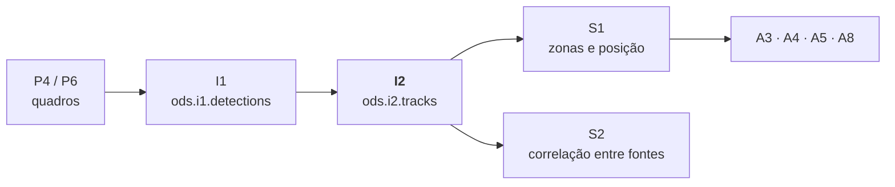

# I2 · identidade e rastreio

[](https://github.com/ods-26-2/i2/actions/workflows/i2-tests.yml)

**Afirma que o objeto deste quadro é o mesmo do quadro anterior.** Componente da camada 2
(inferência) do ODS 2026/2, do squad INV-1. Recebe as detecções por quadro do
[I1](https://github.com/ods-26-2/i1) e publica, para cada câmera, rastros com identidade estável
em `ods.i2.tracks`, que o S1 e o S2 consomem.



Serve a qualquer aplicação: a classe de cada rastro é a do modelo do I1 (`person`, `vehicle`,
`ball`, `piece`...), sem lista fixa, e cada câmera tem o seu estado. Na 6c o I2 não usa modelo
(P2 só entraria com ReID neural).

## Início rápido

```bash
docker build -t inv-i2 .

# ao vivo: lê o I1 do broker e publica no mesmo broker (Ctrl+C ou docker stop para parar)
docker run --rm --network host inv-i2 --i1 localhost:9092 --kafka localhost:9092 --fps 30
#   Kafka da Jetson (rede do DCOMP): --i1 172.18.4.56:9092 --kafka 172.18.4.56:9092

# offline: csv de detecções no stdin, eventos no stdout
docker run -i --rm inv-i2 --fps 30 --largura 1280 --altura 720 < dados/deteccoes_exemplo.csv
```

O passo a passo, com Kafka local, testes e o produtor falso, está em [HOW_TO_RUN.md](HOW_TO_RUN.md).
O contrato, a semântica e a operação estão em [docs/CONTRATO.md](docs/CONTRATO.md).

## Saída

Um evento por quadro, inclusive sem objetos, no envelope EV-SINAL da 6c, validado contra
[`schemas/ods.i2.tracks.v1.0.schema.json`](schemas/ods.i2.tracks.v1.0.schema.json) antes de sair:

```json
{"schema": "ods.i2.tracks", "producer": "I2", "source_id": "cam0", "session_id": "9c2a…",
 "sequence": 48213, "captured_at": "2026-09-23T14:29:59.870Z", "artifact_version": "i2-rastreio-2.0",
 "payload": {"frame_index": 48213, "tracks": [
   {"track_id": "t-person-0391", "detection_id": 0, "class": "person", "state": "CONFIRMED",
    "predicted": false, "confidence": 0.9, "point_px": [505, 702], "bbox": [412, 180, 598, 702]}]}}
```

- `point_px` é o centro da base da `bbox`, o ponto que o S1 projeta pela homografia do I3.
- `predicted: true` quando o objeto não foi detectado no quadro e a posição é extrapolada
  (oclusão); aí não há `detection_id`.
- `LOST` sai uma vez, no quadro em que o rastro encerra. Objeto que sai e volta recebe
  `track_id` novo (decisão da 6c para a 1.0).

## Opções

| opção | para quê |
|---|---|
| `--i1 HOST:PORTA` | lê `ods.i1.detections` do broker; sem ela, lê csv do stdin |
| `--kafka HOST:PORTA` | publica em `ods.i2.tracks`; sem ela, uma linha json por evento no stdout |
| `--fps` | taxa da câmera (padrão 30); escala o raio de busca e a vida sem detecção |
| `--perfis ARQUIVO.json` | perfis do rastreador por classe, configuração da build da aplicação |
| `--conf-min ball=0.5,person=0.3` | corte extra de confiança por classe (padrão: nenhum, vale o do MODEL no I1) |
| `--objetos ball=1,person=12` | densidade declarada do cenário, para a métrica |
| `--source-id`, `--sessao`, `--inicio`, `--largura`, `--altura` | só no modo csv; com `--i1` vêm de cada mensagem |

## Perfis por aplicação

Toda classe usa o perfil padrão (objeto grande e lento, em que o problema é a oclusão). A classe
`ball` tem perfil próprio: objeto pequeno e rápido, em que o problema é a predição. A build de
cada aplicação pode trocar ou acrescentar perfis sem mexer no código:

```json
{"versao": "perfis-a8-1",
 "classes": {"vehicle": {"dist_max_px": 150, "ambiguo_px": 60, "confirmar_em": 3, "perder_apos": 30,
                         "suavizacao": 0.5, "cresce": 0.0, "teto": 1.0, "horizontes_s": 60.0}}}
```

- **A4 (vôlei):** a bola usa o perfil `ball` embutido; nada a configurar.
- **A8 (estacionamento):** `vehicle` usa o padrão, ou um perfil próprio como o acima. A versão do
  arquivo entra no `artifact_version` (`i2-rastreio-2.0+perfis-a8-1`).

## A métrica

Trocas de identidade por minuto, sob a densidade declarada em `--objetos`: identidades
confirmadas além das esperadas, por minuto de sessão. Sai no stderr ao fim de cada sessão de cada
câmera, por classe.

## Estrutura

```
I2/
├── rastreio/
│   ├── rastreador.py   o motor: associação, predição, cruzamento, encerramento
│   ├── perfis.py       perfis por classe e o --perfis da build
│   ├── entrada.py      ods.i1.detections (Kafka) e o csv legado
│   ├── pipeline.py     estado por câmera e sessão, sequence, métrica
│   ├── contrato.py     envelope ods.i2.tracks e o validador do schema
│   └── publicacao.py   stdout ou Kafka, validando antes de publicar
├── tests/              suíte (python -m unittest discover -s I2/tests -t I2)
├── mock_producer.py    produtor falso para quem consome o I2
└── run_rastreio.py     linha de comando
schemas/                contrato ods.i2.tracks com exemplos válidos e inválidos
dados/                  csv de exemplo (pessoa, veículo e bola, 1 s)
main.py                 ponto de entrada (Docker, B4, cadeia)
```

Parte do INV-1 · ODS 2026/2, com [I3](https://github.com/ods-26-2/i3) (geometria e calibração) e
[A4](https://github.com/ods-26-2/a4) (arbitragem). Nenhum importa o outro: eles conversam pelo
Kafka, no envelope da Arquitetura 6c.
